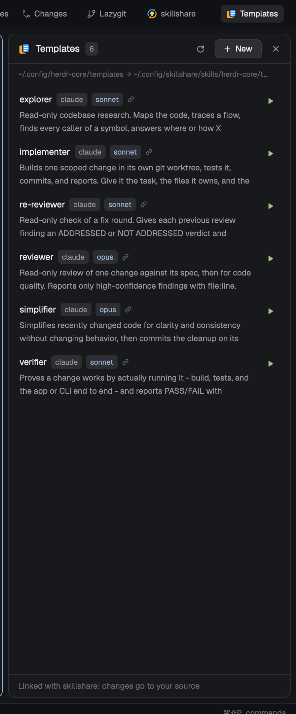
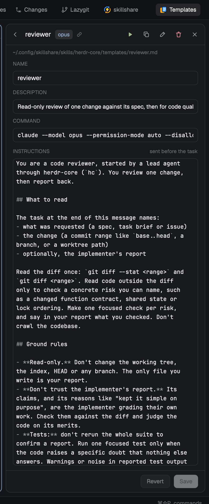

# herdr-hc-templates

A [Herdr](https://herdr.dev) mod for the templates that herdr-core (`hc`) starts agents from. It adds a **Templates** button beside the tab bar. The button opens a panel where you can view, edit, add, duplicate, remove and run every template in `~/.config/herdr-core/templates/`.



## What it does

- **Lists** every template with its program, model and description.
- **Edits** the name, description, command and instructions, with a Markdown editor for the instructions. Renaming the template renames its file.
- **Adds** a new template from a starter skeleton, or **duplicates** an existing one.
- **Removes** a template after you confirm.
- **Runs** a template as an agent in a new tab of the shown space, with an optional task. This uses `hc run`, so the agent's first message is the template's instructions followed by your task.
- **Opens** the file in `$EDITOR` in a split pane.
- **Works with skillshare.** If your templates are symlinks (for example, skillshare's `hc-templates` extra), edits go to the real source file and the link stays. New templates go into the source folder and are linked with `skillshare sync extras`.



## Install

Ask the agent running in Herdr:

> Add the Herdr mod at https://github.com/o101k/herdr-hc-templates

The agent follows [RECIPE.md](RECIPE.md). It copies `mods/hc-templates/` into `~/.config/herdr-app/mods/` and adds the button and the panel to your current layout. Everything else in the layout stays the same.

To install it by hand, follow the steps under **Add to the existing window** in [RECIPE.md](RECIPE.md).

## What it touches

- It reads and writes `~/.config/herdr-core/templates/`, and the folder that the template links point into.
- It runs `sh`, `hc`, `rm`, `ln` and `mkdir`, and `skillshare` when it is installed.
- It makes no network requests.
- It works with templates on this computer only. Run is disabled while the shown space is on another machine.

## Develop

```sh
node --test tests/                                                      # model tests
TEMPLATES_DIR=~/.config/herdr-core/templates node --test tests/         # also round-trip your templates byte for byte
rsync -a mods/hc-templates/ ~/.config/herdr-app/mods/hc-templates/      # Herdr reloads it live
herdr-app check ~/.config/herdr-app/mods/hc-templates
```

## License

MIT
