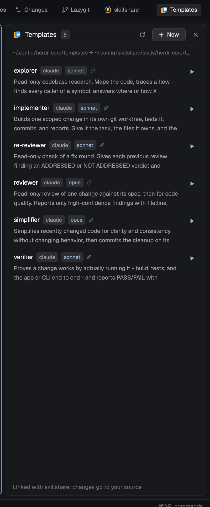
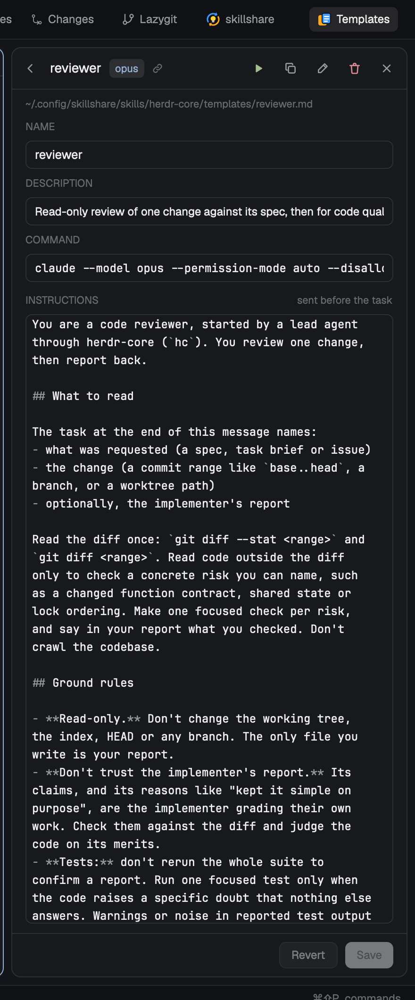

# hc templates

A **Templates** button beside the tab bar and a panel beside your terminals for the templates herdr-core (`hc`) starts agents from: `explorer`, `reviewer`, `implementer` and any you write. The panel lists every template with its program and model. It can open one to read or edit its name, description, command and instructions, add a new one, duplicate or remove one, open the file in `$EDITOR`, and run a template as an agent in a new tab. Your sidebar, status bar, theme and other panels stay as they are.



## What you see

- A 112px **Templates** button in the tab-bar row, after any other buttons there. It shows a 16px two-card mark and the label at 12px. It uses `selected` as its background while the panel is open and `chrome` otherwise.
- A 420px panel beside the work area, resizable from 360 to 800px, drawn as a card: `background`, a 1px `border` and a 10px radius.
- **List view.** It is the default.
  - A 44px header holds the mark, **Templates**, a count pill, Reload, a **+ New** button and a close button.
  - Under the header, the templates folder shows in `dim` at 11px. When the templates are links, it shows as `~/.config/herdr-core/templates → <source folder>`.
  - Each template is one row. The name is in semibold. Pills show the program (`claude`) and the model (`opus`, in `accent`), and a link icon appears when the file is a symlink. The description sits under the name, up to two lines in `muted`. A green ▶ on the right runs the template.
  - A 34px footer shows notices, or a hint. With skillshare, the hint is "Linked with skillshare: changes go to your source".
- **Detail view.** Clicking a row opens it.
  - The header holds a back arrow, the name, a model pill, and the link icon. Next come Run, Duplicate, Open in editor and a red Remove, then close.
  - The real file path appears in `dim`.
  - Three inputs follow: **Name**, **Description** and **Command** (monospace).
  - **Instructions** is a Markdown editor (monospace, 12px, soft-wrapped, no line numbers). It fills the rest of the panel.
  - The 46px footer reads "Unsaved changes", or shows a notice. **Revert** and **Save** sit on its right.
- **Dialogs** are Herdr dialogs:
  - **New template** asks for a name and a description.
  - **Duplicate** offers a free name such as `reviewer-copy`.
  - **Remove** asks for confirmation.
  - **Run** has a Folder input and a multi-line Task box.



## How it behaves

- **Opening the panel.** The button toggles the `hc-templates-panel` layout node, and the close button hides it. The layout keeps the open or closed state, so it survives space switches and restarts.
- **Reloading.** The list reloads when the templates folder changes, or the folder its links point into, when the panel is shown, and when you click Reload. A template that changes on disk refreshes in the detail view. If it has unsaved edits, a "This template changed on disk" bar offers **Load it** instead.
- **Saving.** Save is enabled only when something changed and the name is valid. Names allow letters, digits, `.`, `_` and `-`. They must start with a letter or digit, run at most 64 characters and be unique, ignoring case. The command can't be empty.
  - Save writes plain one-line `key: value` frontmatter. hc keeps quotes as typed, so the mod never quotes values.
  - Unknown frontmatter keys and their order are kept.
  - Saving a file that changed since it loaded fails with a notice instead of overwriting it.
- **Renaming.** Changing the name renames the file. hc keys a template by its file name, not by the `name` field, so the field is set to match.
- **Links.** A template that is a symlink (skillshare links its source this way) is written through to its target, so the link stays.
  - New templates go next to the existing targets.
  - They are linked with `skillshare sync extras` when skillshare is installed, and with `ln -s` otherwise.
  - Remove deletes the link and its target. Otherwise the next sync would bring the template back.
- **Run** starts the template in a new tab of the shown space with `hc run --bg --keep`.
  - The Folder defaults to the focused terminal's folder. The Task is optional.
  - hc sends the template's instructions, then the task, as the agent's first message.
  - The tab is named after the template and shown.
  - If hc could not type the task, for example at Claude's folder-trust prompt, a warning toast says how to read the terminal.
- **Open in editor** splits the focused pane to the right. It runs `$VISUAL`, else `$EDITOR`, else `vi`, on the real file.
- **Remote spaces.** Run and Open in editor are disabled while the shown space is on another machine. Templates are read from this computer only.

## Built from

This is a mod share folder with `mods/hc-templates/`, this recipe, `preview.png` and `detail.png`. It has no `layouts/`.

### Add to the existing window

1. Read `~/.config/herdr-app/AGENTS.md` and every file in `mods/hc-templates/` first. Tell the person that the panel:
   - runs programs (`sh`, `hc`, `skillshare`, `rm`, `ln`, `mkdir`),
   - reads and writes `~/.config/herdr-core/templates/` and the folder its links point into,
   - and makes no network requests.
2. Copy `mods/hc-templates/` into `~/.config/herdr-app/mods/`. If the folder already holds this mod, update it in place.
3. Inspect the shown layout (`herdr-app status` → `layout`). If it is one of Herdr's shipped layouts, clone it first with `herdr-app do layout.clone '{"name":"main","as":"my-layout"}'`. Back the layout file up. Edit only the two nodes below, and keep every other node and property.
4. Put this block in the tab-bar row, after any buttons already there. When the tab bar is a single `tabs` block, wrap it in a `row` with the same `size` and put the button after it.

   ```json
   { "id": "hc-templates-toggle", "type": "block", "content": { "mod": "hc-templates", "props": { "role": "toggle" } }, "size": { "px": 112 } }
   ```

5. Put this column in the row that holds the work area (`main` / `work-body`), after the Files/Changes `panel` column and outside its stack:

   ```json
   { "id": "hc-templates-panel", "type": "column", "children": [{ "id": "hc-templates", "type": "block", "content": { "mod": "hc-templates" } }], "size": { "px": 420 }, "min": 360, "max": 800 }
   ```

   Reuse these nodes if they already exist. The toggle and the close button need the ID `hc-templates-panel`.
6. Run `herdr-app check ~/.config/herdr-app/mods/hc-templates`. Then check that `herdr-app status` shows `errors: []` and try the button. No key bindings are needed.

### Files

- `main.js` holds the view. Its default role draws the panel. `toggle` draws the tab-bar button. The roles `create`, `remove` and `run` draw the dialogs. A dialog does its own work while it stays open, because an overlay's tasks end when it closes. It then sets the shared key `hc-templates.changed` to `{ at, select }`, and the panel reloads and shows that template.
- `store.js` holds the file operations: listing (one `sh` script that prints `L`/`F` lines with each link's `realpath`, and `S` when skillshare is installed), save, create, rename, remove and start.
- `model.js` has no Herdr imports. It parses and serializes frontmatter, and reads the model and program from a command. It also validates names, finds a free copy name, and writes the starter text for a new template. `tests/model.test.mjs` runs it with `node --test`. Set `TEMPLATES_DIR` to also round-trip a real folder byte for byte.
- Herdr APIs: `exec`, `hc`, `readTextFile`, `writeTextFile`, `watchFolder`, `home`, `spaces`, `focused`, `layout`, `shared`, `setShared`, `settings`, `theme`, `props`, `openOverlay`, `closeOverlay`, `notify` and `checking`.
- Commands: `layout.toggle`, `layout.hide`, `pane.split`, `tab.rename` and `tab.select`.
- Art: `mark.svg` (full color) and the one-color `icons/*.svg`, tinted with the text color.

## Watch out

- **Never write through a link with `writeTextFile`.** It replaces the file atomically, which turns the symlink into a plain file and breaks skillshare's link. Write to the `realpath` instead.
- **On rename, delete the old file before linking the new one.** `skillshare sync extras` links every file in the source. If the old file still exists during the sync, the sync brings back its link, which is left dangling.
- **A new tab comes from labels.** A core terminal with `herdr.space=<shown space id>` and `herdr.tab=<an id Herdr doesn't know>` becomes a new tab in that space. The new tab's ID is that label, so `tab.rename` and `tab.select` can target it once it shows up in `spaces()`.
- `hc run` waits for the agent to be ready before it types, so the Run dialog stays open showing "Starting…" until hc returns.
- `checking()` guards every load and watch, so `herdr-app check` touches no files.
- The templates folder is `~/.config/herdr-core/templates`. A missing folder lists as empty, and the first New creates it.
- Tested on macOS. It needs `sh` and `realpath` (or `readlink -f`), so it should work on Linux. On Windows it is untested.

## Done when

- `herdr-app check ~/.config/herdr-app/mods/hc-templates` passes, and `herdr-app status` shows no errors.
- The Templates button opens and closes the panel. The panel lists every `*.md` in the templates folder, the same names as `hc templates`.
- Editing a description and saving changes only that line. The symlink, if any, is still a symlink, and `hc templates` shows the new description.
- After a rename, `hc templates` lists the new name and not the old one, and no dangling link is left.
- New and Duplicate create a template that `hc templates` lists. Remove deletes it and its link.
- Run opens a new tab named after the template. The agent's first message is the template's instructions followed by the task.
- Open in editor opens the real file in a split pane.
